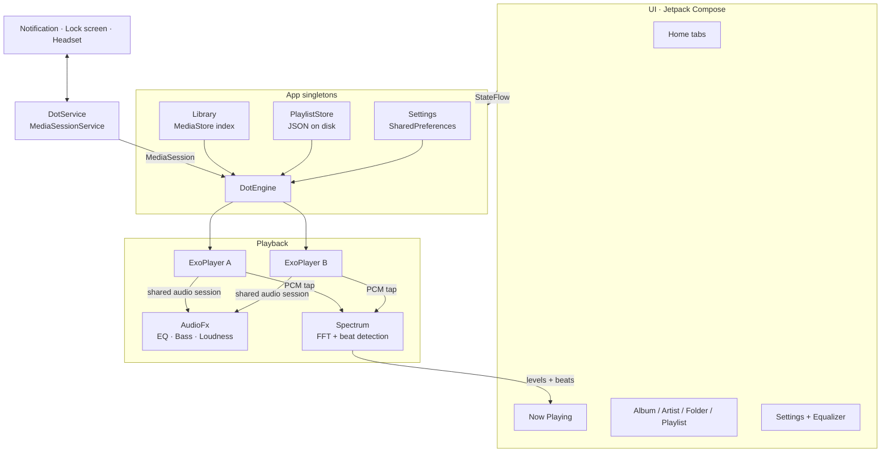
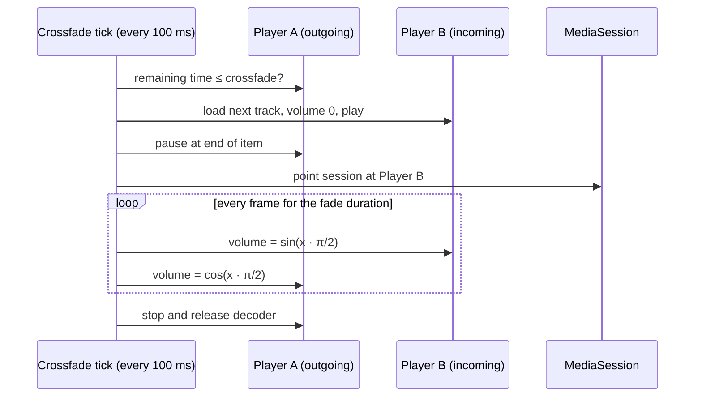
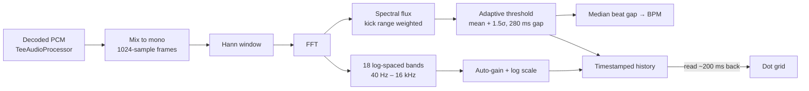

# Dot

An offline music player for Android, designed around the Nothing OS look: pure black, dot-matrix type, a single red accent. Built for the Nothing Phone (4a), runs on any phone with Android 10 or newer.

Dot plays the music that lives on your phone. No accounts, no streaming, no ads, no network calls.

## Features

**Playback**
- Crossfade between tracks on an equal-power curve, adjustable from off to 12 seconds
- Short blend when skipping, soft fade on play and pause
- Gapless playback when crossfade is off
- Shuffle, repeat all, repeat one, playback speed from 0.5x to 2x
- Queue editing: play next, add to queue, reorder, remove
- Sleep timer with a gentle fade out, including "end of this song"
- Picks up where you left off: queue, track and position survive restarts

**Sound**
- Equalizer with presets (Bass Boost, Bass + Treble, Vocal, Treble, Rock, Pop, Electronic, Classical) and per-band dot sliders
- Bass boost and loudness enhancer
- Lossless formats: FLAC, ALAC, WAV, plus Opus, Vorbis, MP3 and AAC

**Visuals**
- Glyph-style dot-matrix spectrum visualizer on the Now Playing screen
- Real-time beat detection: the grid pulses on every hit, with a live BPM readout
- Synced lyrics from `.lrc` files or embedded tags, auto-scrolling with tap-to-seek

**Library**
- Songs, albums, artists, folders and playlists
- Favourites, Recently added and Most played lists
- Search across songs, albums and artists
- Re-indexes automatically when music is added or removed
- Hides voice notes and ringtones below a minimum length

**System**
- Keeps playing in the background and with the screen locked
- Lock-screen and notification controls with album art
- Headset and Bluetooth buttons, pauses for calls, ducks for navigation, pauses when headphones disconnect

## Architecture



The UI never talks to ExoPlayer directly. Everything goes through `DotEngine`, which exposes its state as `StateFlow` and owns both players. `DotService` wraps the engine in a Media3 `MediaSession`, so the system's media controls drive the same code paths as the app's buttons.

## How crossfade works

A single ExoPlayer can't play two tracks at once, so Dot runs two. The active player holds the whole queue, which keeps gapless playback and notification controls working natively. When a fade begins, the spare player loads the next track and the roles swap.



Details that make it smooth:

- **Equal-power curve.** Sine in, cosine out keeps perceived loudness constant through the blend, where a linear fade dips in the middle.
- **Waits for the decoder.** The fade clock only starts once the incoming track is ready, so the first beat isn't lost.
- **Interruptible.** Skipping mid-fade cuts the old outgoing track and fades out from whatever volume the current one has reached.
- **One audio focus owner.** The engine requests focus itself. Two players requesting it separately would pause each other.
- **One audio session.** Both players share a session ID, so the equalizer applies to both sides of a fade.

## How the visualizer and beat detection work

Most Android visualizers need microphone permission. Dot taps the decoded audio straight out of ExoPlayer instead, so it needs no extra permission and only hears the music.



- **Levels.** Each 23 ms frame is turned into 18 frequency bands, normalised against a slowly decaying peak so quiet and loud tracks both fill the grid.
- **Beats.** Spectral flux measures how much energy *rose* since the previous frame, mostly in the 30 to 180 Hz kick range. A beat fires when that rise clears the recent average by a margin, with a refractory gap so one hit can't fire twice. The median interval between beats gives the BPM.
- **Sync.** Audio is decoded ahead of the speaker by the output buffer. Every frame is timestamped and the screen draws the one that is audible now, not the one just decoded.
- **Battery.** Analysis only runs while the Now Playing screen is visible.

## Tech stack

| Area | Choice |
| --- | --- |
| Language | Kotlin |
| UI | Jetpack Compose, Material 3 (restyled) |
| Playback | AndroidX Media3 ExoPlayer and MediaSession |
| Audio effects | `android.media.audiofx` Equalizer, BassBoost, LoudnessEnhancer |
| Library | MediaStore with a content observer |
| Storage | SharedPreferences and a JSON file, no database |
| Fonts | Doto (dot matrix) and Space Mono |

No image loading library: album art comes from `ContentResolver.loadThumbnail` with an in-memory LRU cache.

## Project structure

```
app/src/main/java/com/dj/dot
├── DotApp.kt            app singletons
├── MainActivity.kt      edge-to-edge host, binds the media controller
├── data/
│   ├── Models.kt        Song, Album, Artist, Folder, Playlist
│   ├── Library.kt       MediaStore scan and auto-rescan
│   ├── PlaylistStore.kt playlists, favourites, play counts
│   └── Settings.kt      typed preferences as StateFlows
├── playback/
│   ├── DotEngine.kt     dual-player engine, crossfade, focus, queue
│   ├── DotService.kt    media session service and notification art
│   ├── AudioFx.kt       equalizer, presets, bass, loudness
│   ├── Spectrum.kt      FFT, bands, beat detection, BPM
│   └── Lyrics.kt        LRC, ID3 USLT and Vorbis lyrics
└── ui/
    ├── Theme.kt         colours and type
    ├── Components.kt    pills, dot sliders, art, visualizer
    ├── Root.kt          navigation, permissions, mini player
    ├── Home.kt          library tabs
    ├── Details.kt       album, artist, folder, playlist
    ├── NowPlaying.kt    player, lyrics, queue, sleep timer
    ├── SearchScreen.kt
    ├── SettingsScreen.kt settings and equalizer
    └── Sheets.kt        song menu, playlist picker, dialogs
```

## Building

Requirements: JDK 17 or newer and the Android SDK (platform 36).

```bash
git clone https://github.com/dhananjay6561/dot.git
cd dot
echo "sdk.dir=/path/to/android/sdk" > local.properties
./gradlew assembleDebug
```

The APK lands in `app/build/outputs/apk/debug/`.

## Installing on a phone

1. Enable Developer options: **Settings → About phone → tap Build number 7 times**.
2. Turn on **USB debugging** in Developer options and connect the phone.
3. Run:

```bash
./gradlew installDebug
```

Or copy the APK to the phone and open it, allowing installs from that source when asked.

### Recommended on first launch

- Allow music access when prompted.
- **Settings → Keep playing in background** exempts Dot from battery optimisation, so the system never stops playback.
- **Settings → Lyrics file access** is only needed if you keep `.lrc` files next to your songs.

## Permissions

| Permission | Why |
| --- | --- |
| `READ_MEDIA_AUDIO` | Read your music |
| `POST_NOTIFICATIONS` | Playback notification |
| `FOREGROUND_SERVICE_MEDIA_PLAYBACK` | Keep playing in the background |
| `WAKE_LOCK` | Don't stall with the screen off |
| `REQUEST_IGNORE_BATTERY_OPTIMIZATIONS` | Optional, asked from Settings |
| `MANAGE_EXTERNAL_STORAGE` | Optional, only for `.lrc` files |

Dot has no internet permission.

## Roadmap

- Format badge on Now Playing (codec, bit depth, sample rate)
- Headphone surround mode and Android spatializer support
- Bit-perfect output for USB DACs on Android 14+
- Home-screen widget

## Credits

- [Doto](https://fonts.google.com/specimen/Doto) and [Space Mono](https://fonts.google.com/specimen/Space+Mono), both under the SIL Open Font License
- [AndroidX Media3](https://github.com/androidx/media)
- Library and queue ideas inspired by open-source players such as Auxio
