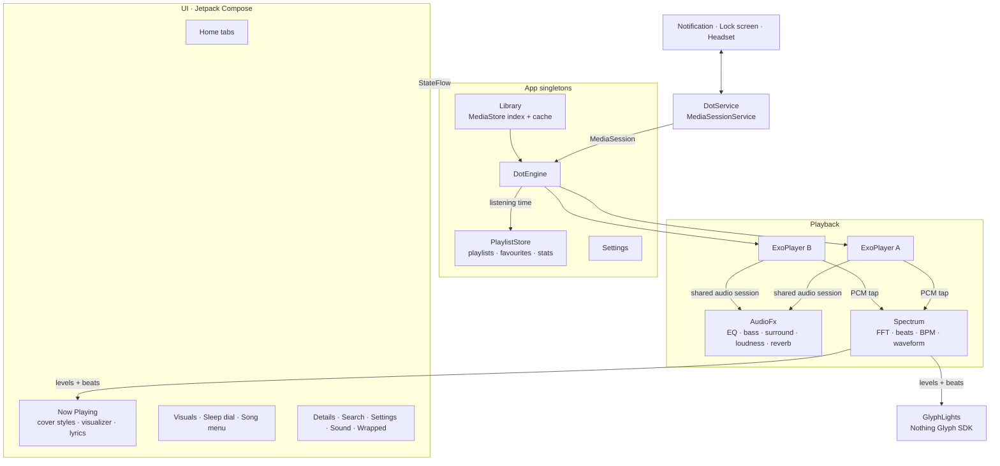
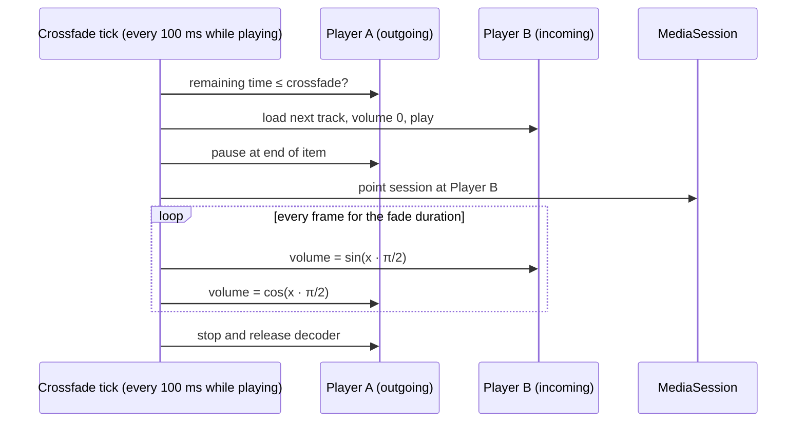
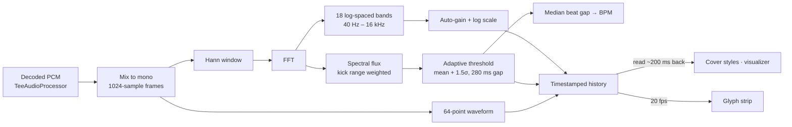

# Dot

An offline music player for Android, designed around the Nothing OS look: pure black, dot-matrix type, a single red accent. Built for the Nothing Phone (4a), and it runs on any phone with Android 10 or newer. On Nothing phones it also drives the Glyph lights on the back.

Dot plays the music that lives on your phone. No accounts, no streaming, no ads, no network calls.

## Features

**Playback**
- Crossfade between tracks on an equal-power curve, adjustable from off to 12 seconds
- Short blend when skipping, soft fade on play and pause
- Gapless playback when crossfade is off
- Shuffle, repeat all, repeat one, playback speed from 0.5x to 2x
- Queue editing: play next, add to queue, reorder, remove
- Picks up where you left off: queue, track and position survive restarts
- Swiping Dot away from recents stops the music

**Sleep timer**
- Analog dial: drag the knob around the face, one turn per hour, up to three hours
- Each hour fills its own ring of dots, with the stop time shown in the middle
- Quick presets, "end of this song", and a gentle fade out before stopping

**Sound**
- One-tap sound modes: Hi-Fi, Bass Boost, Super Bass, Panoramic, Concert, Vocal, Club, Cinema
- Equalizer with nine presets and per-band dot sliders
- Bass boost, Panoramic 3D surround, loudness and room reverb (Room, Studio, Hall, Arena, Plate)
- Lossless formats: FLAC, ALAC, WAV, plus Opus, Vorbis, MP3 and AAC

**Visuals**
- Three cover styles, switched by tapping the art:
  - **Cover:** the album art; wide or tall covers are shown in full over a blurred fill
  - **Dot art:** the cover redrawn as a colour halftone that swells and ripples on every beat
  - **Halo:** a round cover with dot spokes following the spectrum and red rings rippling out on beats
- Three visualizer styles, switched by tapping the strip: **Grid**, **Mirror** and **Wave**
- Real-time beat detection with a live BPM readout
- A Visuals panel with live previews of every style, rendered from the song that's playing

**Glyph lights** (Nothing Phone (4a))
- The rear light strip reacts to the music:
  - **Meter:** the six LEDs climb with the bass, with smooth per-LED brightness
  - **Pulse:** the whole strip flashes on every beat
  - **Progress:** the strip fills as the song plays
- Brightness, sensitivity and beat-flash controls, with a live on-screen mirror of the strip
- Controlled from the Glyph button on Now Playing or from Settings

**Lyrics**
- Synced `.lrc` files and lyrics embedded in ID3 or Vorbis tags
- Karaoke fill: the current line lights up left to right as it's sung, including wrapped lines
- The current line stays in focus with smooth scrolling and fading neighbours
- Breathing dots during instrumental breaks
- Tap any line to jump there; scroll freely and it re-syncs on its own
- Per-song timing offset for files that run early or late
- Finds `.lrc` files even when their names don't match the song file exactly

**Library**
- Songs, albums, artists, folders and playlists
- Favourites, Recently added and Most played lists
- Search across songs, albums and artists
- Fast scroller with a letter bubble on long lists
- Cleans download-site junk from tags for display, such as "(DjPunjab.CoM)", "- PagalNew" or "320 Kbps"; files are never modified
- Hides WhatsApp voice notes and clips below a minimum length
- Opens instantly from a cached index and only rescans when Android reports a change

**Dot Wrapped**
- Total listening time, top artists, top songs and a day streak
- A listening clock showing when in the day you listen, and the last seven days
- A listener type (Early bird, Daydreamer, Evening soul, Night owl)
- A summary card you can share as an image

**Feel**
- Nothing-style dot-matrix sliders that grow under your finger, with value bubbles and haptic ticks
- Buttons and pills squish on press, icons scale and cross-fade when they change, colours fade between states
- Liking a song pops the heart

**System**
- Keeps playing in the background and with the screen locked
- Lock-screen and notification controls with album art
- Headset and Bluetooth buttons, pauses for calls, ducks for navigation, pauses when headphones disconnect

## Architecture



The UI never talks to ExoPlayer directly. Everything goes through `DotEngine`, which exposes its state as `StateFlow` and owns both players. `DotService` wraps the engine in a Media3 `MediaSession`, so the system's media controls drive the same code paths as the app's buttons. The spectrum analyser is shared: the on-screen visuals and the Glyph strip each hold a reference, and it does no work when nobody is listening.

## How crossfade works

A single ExoPlayer can't play two tracks at once, so Dot runs two. The active player holds the whole queue, which keeps gapless playback and notification controls working natively. When a fade begins, the spare player loads the next track and the roles swap.



- **Equal-power curve.** Sine in, cosine out keeps perceived loudness constant through the blend, where a linear fade dips in the middle.
- **Waits for the decoder.** The fade clock only starts once the incoming track is ready, so the first beat isn't lost.
- **Interruptible.** Skipping mid-fade cuts the old outgoing track and fades out from whatever volume the current one has reached.
- **One audio focus owner.** The engine requests focus itself. Two players requesting it separately would pause each other.
- **One audio session.** Both players share a session ID, so the equalizer applies to both sides of a fade.

## How the visualizer, beats and Glyph lights work

Most Android visualizers need microphone permission. Dot taps the decoded audio straight out of ExoPlayer instead, so it needs no extra permission and only hears the music.



- **Levels.** Each 23 ms frame becomes 18 frequency bands, normalised against a slowly decaying peak so quiet and loud tracks both fill the grid.
- **Beats.** Spectral flux measures how much energy *rose* since the previous frame, mostly in the 30 to 180 Hz kick range. A beat fires when that rise clears the recent average by a margin, with a refractory gap so one hit can't fire twice. The median gap between beats gives the BPM.
- **Sync.** Audio is decoded ahead of the speaker by the output buffer. Every frame is timestamped and readers take the one that is audible now, not the one just decoded.
- **Glyph strip.** The low bands drive a six-LED meter with per-LED brightness, beats flash the whole strip, and frames are only sent over the binder when they visibly change.

## Performance

Dot is built to stay light on battery and memory:

- The engine tick runs only while music plays and sleeps completely when paused.
- Visuals render at most 60 fps, even on 120 Hz screens, and stop once the music is paused and the dots have settled.
- Dot art paints its halftone once into a bitmap; each frame only scales it and lights the ripple band.
- The analyser runs only while a visual or the Glyph strip is using it; the waveform is skipped when only the strip listens.
- Analyser buffers are reused instead of reallocated on every frame.
- Listening stats are written once a minute and on pause, not continuously.
- The library opens from a cached index and only rescans when MediaStore's change counter moves.
- Album art comes from `ContentResolver.loadThumbnail` with an in-memory LRU cache, with no image library.
- Release builds are shrunk and optimised with R8.

## Tech stack

| Area | Choice |
| --- | --- |
| Language | Kotlin |
| UI | Jetpack Compose, Material 3 (restyled) |
| Playback | AndroidX Media3 ExoPlayer and MediaSession |
| Audio effects | `android.media.audiofx` Equalizer, BassBoost, Virtualizer, LoudnessEnhancer, PresetReverb |
| Glyph | Nothing Glyph Developer Kit |
| Library | MediaStore with a content observer and a cached index |
| Storage | SharedPreferences and JSON files, no database |
| Fonts | Doto (dot matrix) and Space Mono |

## Project structure

```
app/src/main/java/com/dj/dot
├── DotApp.kt              app singletons
├── MainActivity.kt        edge-to-edge host, binds the media controller
├── data/
│   ├── Models.kt          Song, Album, Artist, Folder, Playlist
│   ├── Library.kt         MediaStore scan, cache and auto-rescan
│   ├── TagCleaner.kt      strips download-site junk from tags
│   ├── PlaylistStore.kt   playlists, favourites, play counts, listening stats
│   └── Settings.kt        typed preferences as StateFlows
├── playback/
│   ├── DotEngine.kt       dual-player engine, crossfade, focus, queue
│   ├── DotService.kt      media session service and notification art
│   ├── AudioFx.kt         equalizer, sound modes, surround, reverb
│   ├── Spectrum.kt        FFT, bands, beats, BPM, waveform
│   ├── GlyphLights.kt     rear light strip modes
│   └── Lyrics.kt          LRC, ID3 USLT and Vorbis lyrics, lrc matching
└── ui/
    ├── Theme.kt           colours and type
    ├── Components.kt      pills, sliders, art, fast scroller, press animations
    ├── Root.kt            navigation, permissions, mini player
    ├── Home.kt            library tabs
    ├── Details.kt         album, artist, folder, playlist
    ├── NowPlaying.kt      player, queue, sleep sheet
    ├── Visualizers.kt     grid, mirror, wave, dot art, halo
    ├── VisualsSheet.kt    visuals and Glyph panel with live previews
    ├── LyricsView.kt      karaoke lyrics
    ├── SleepDial.kt       analog sleep timer
    ├── WrappedScreen.kt   listening stats
    ├── SearchScreen.kt
    ├── SettingsScreen.kt  settings and the sound screen
    └── Sheets.kt          song menu, playlist picker, dialogs
```

## Building

Requirements: JDK 17 or newer and the Android SDK (platform 36).

```bash
git clone https://github.com/dhananjay6561/dot.git
cd dot
echo "sdk.dir=/path/to/android/sdk" > local.properties
./gradlew assembleRelease
```

The APK lands in `app/build/outputs/apk/release/`. The first build downloads the Nothing Glyph SDK from its [official repository](https://github.com/Nothing-Developer-Programme/Glyph-Developer-Kit) into `app/libs/`, since it isn't published to Maven.

## Installing on a phone

1. Enable Developer options: **Settings → About phone → tap Build number 7 times**.
2. Turn on **USB debugging** or **Wireless debugging** in Developer options and connect the phone.
3. Run:

```bash
./gradlew installRelease
```

Or copy the APK to the phone and open it, allowing installs from that source when asked.

### Recommended on first launch

- Allow music access when prompted.
- **Settings → Keep playing in background** exempts Dot from battery optimisation, so the system never stops playback.
- **Settings → Lyrics file access** is only needed if you keep `.lrc` files next to your songs.
- On a Nothing Phone (4a), open the Glyph button on Now Playing and pick a light mode.

## Permissions

| Permission | Why |
| --- | --- |
| `READ_MEDIA_AUDIO` | Read your music |
| `POST_NOTIFICATIONS` | Playback notification |
| `FOREGROUND_SERVICE_MEDIA_PLAYBACK` | Keep playing in the background |
| `WAKE_LOCK` | Don't stall with the screen off |
| `MODIFY_AUDIO_SETTINGS` | Room reverb on the output mix |
| `com.nothing.ketchum.permission.ENABLE` | Drive the Glyph lights on Nothing phones |
| `REQUEST_IGNORE_BATTERY_OPTIMIZATIONS` | Optional, asked from Settings |
| `MANAGE_EXTERNAL_STORAGE` | Optional, only for `.lrc` files |

Dot has no internet permission.

## Roadmap

- Dot's own audio engine: 10-band EQ, bass shelf, stereo widening, limiter and volume levelling
- Party mode: a full-screen landscape visualizer
- Gestures: double-tap to like, swipe up for the queue, shake for a random song
- Beat-matched crossfade
- Home-screen widget and Quick Settings tile
- Format badge (codec, bit depth, sample rate)
- Backup and restore of playlists and stats

## Credits

- [Doto](https://fonts.google.com/specimen/Doto) and [Space Mono](https://fonts.google.com/specimen/Space+Mono), both under the SIL Open Font License
- [AndroidX Media3](https://github.com/androidx/media)
- [Nothing Glyph Developer Kit](https://github.com/Nothing-Developer-Programme/Glyph-Developer-Kit)
- Library and queue ideas inspired by open-source players such as Auxio
